# Лабораторна робота 2. Створення складних SQL запитів

## Загальна інформація

**Здобувач освіти:** [Ваше ПІБ]
**Група:** [Номер групи]
**Обраний рівень складності:** 3

**Середовище:** Supabase (PostgreSQL), навчальна база даних `technomart` з ЛР1 (таблиці: `customers`, `products`, `employees`, `orders`, `categories`, `regions`, `suppliers`, `order_items`).

> Примітка щодо складності. Обсяг даних у навчальній базі невеликий (25 товарів, 31 замовлення, 47 позицій замовлень, 15 клієнтів), тому оцінка складності в звіті дана теоретично (для зростання обсягу даних), а час виконання на малих таблицях лежить у межах похибки вимірювання.

---

## Виконання завдань

### Рівень 1

#### 1. З'єднання таблиць

**Завдання 1.1:** INNER JOIN - список товарів з категоріями та постачальниками

```sql
SELECT p.product_name, c.category_name, s.company_name, p.unit_price
FROM products p
INNER JOIN categories c ON p.category_id = c.category_id
INNER JOIN suppliers s ON p.supplier_id = s.supplier_id
ORDER BY c.category_name, p.product_name;
```

**Результат виконання:**


**Пояснення:** запит з'єднує три таблиці: `products` (основна), `categories` та `suppliers` за зовнішніми ключами `category_id` і `supplier_id`. `INNER JOIN` залишає лише ті товари, які мають і категорію, і постачальника.

**Складність:** два послідовні з'єднання за парами PK = FK, `O(n)` за наявності індексів на зовнішніх ключах або Hash Join, плюс сортування `O(n log n)`.

**Оптимізація:** індекси `products(category_id)` та `products(supplier_id)`, якщо таблиця `products` зросте.

**Завдання 1.2:** LEFT JOIN - клієнти з кількістю замовлень

```sql
SELECT c.contact_name, c.customer_type, r.region_name,
       COUNT(o.order_id) AS order_count
FROM customers c
LEFT JOIN orders o ON c.customer_id = o.customer_id
LEFT JOIN regions r ON c.region_id = r.region_id
GROUP BY c.customer_id, c.contact_name, c.customer_type, r.region_name
ORDER BY order_count DESC;
```

**Результат виконання:**


**Пояснення:** `LEFT JOIN` зберігає всіх клієнтів з головної таблиці `customers`, навіть якщо в них немає замовлень (тоді `COUNT(o.order_id)` дає 0, бо NULL не враховується). З `INNER JOIN` такі клієнти зникли б із результату. Другий `LEFT JOIN` додає назву регіону.

**Складність:** два з'єднання та групування, `O(n)` для хеш-агрегації плюс сортування результату.

**Оптимізація:** індекси `orders(customer_id)` та `customers(region_id)`.

**Завдання 1.3:** Множинне з'єднання - детальна інформація про замовлення

```sql
SELECT
    o.order_id,
    o.order_date,
    o.order_status,
    cu.contact_name       AS customer,
    cu.customer_type,
    p.product_name,
    c.category_name,
    s.company_name        AS supplier,
    oi.quantity,
    oi.unit_price,
    oi.discount,
    ROUND(oi.quantity * oi.unit_price * (1 - oi.discount), 2) AS line_total
FROM orders o
    JOIN customers   cu ON o.customer_id = cu.customer_id
    JOIN order_items oi ON o.order_id    = oi.order_id
    JOIN products    p  ON oi.product_id = p.product_id
    JOIN categories  c  ON p.category_id = c.category_id
    JOIN suppliers   s  ON p.supplier_id = s.supplier_id
ORDER BY o.order_date DESC, o.order_id, p.product_name
LIMIT 20;
```

**Результат виконання:**

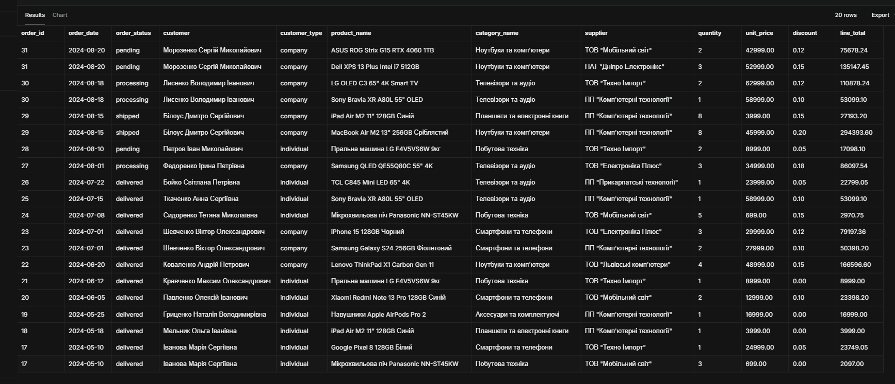

**Аналіз складності:** запит об'єднує 6 таблиць ланцюжком: `orders → customers`, `orders → order_items → products → categories`, `products → suppliers`. Усі з'єднання `INNER JOIN` за парами PK = FK. Замовлення розгортається в позиції, тому одне `order_id` може мати кілька рядків. Вартість визначається таблицею `order_items`, яка множить кількість рядків. Ціна береться з `order_items.unit_price` (ціна на момент замовлення), а не з `products`. Перевірка вручну: замовлення 31, ASUS ROG: 2 × 42999 × (1 − 0.12) = 75678.24, що збігається з `line_total`.

**Оптимізація:** індекси на зовнішні ключі `order_items(order_id)`, `order_items(product_id)`, `products(category_id)`, `products(supplier_id)`, `orders(customer_id)`; `LIMIT` або фільтр за датою для великих таблиць.

#### 2. Агрегатні функції

**Завдання 2.1:** Статистика товарів за категоріями

```sql
SELECT c.category_name,
       COUNT(p.product_id) AS product_count,
       ROUND(AVG(p.unit_price), 2) AS avg_price,
       MIN(p.unit_price) AS min_price,
       MAX(p.unit_price) AS max_price
FROM categories c
LEFT JOIN products p ON c.category_id = p.category_id
GROUP BY c.category_id, c.category_name
ORDER BY product_count DESC;
```

**Результат виконання:**

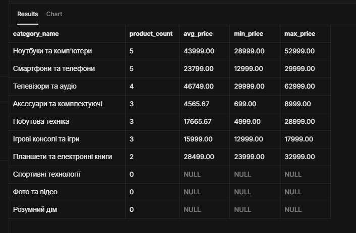

**Пояснення:** `LEFT JOIN` зберігає порожні категорії («Спортивні технології», «Фото та відео», «Розумний дім»): для них `COUNT` = 0, а `AVG/MIN/MAX` = NULL. **Складність:** один прохід по `products`, хеш-групування, `O(n)`. **Оптимізація:** індекс `products(category_id, unit_price)`.

**Завдання 2.2:** Продажі за регіонами з використанням HAVING

```sql
SELECT r.region_name,
       COUNT(DISTINCT o.order_id) AS orders_count,
       SUM(oi.quantity * oi.unit_price * (1 - oi.discount)) AS total_sales
FROM orders o
JOIN customers   cu ON o.customer_id = cu.customer_id
JOIN regions     r  ON cu.region_id  = r.region_id
JOIN order_items oi ON o.order_id    = oi.order_id
GROUP BY r.region_id, r.region_name
HAVING SUM(oi.quantity * oi.unit_price * (1 - oi.discount)) > 100000
ORDER BY total_sales DESC;
```

**Результат виконання:**

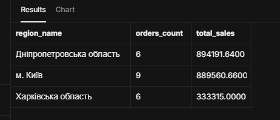

**Пояснення:** виручка підсумовується по регіонах клієнтів (`orders → customers → regions`). `COUNT(DISTINCT order_id)` потрібен, щоб рахувати замовлення, а не позиції. `HAVING` відсікає регіони з сумою нижче 100 000 (умова на агрегат, у `WHERE` її використати не можна). **Складність:** 3 з'єднання, хеш-агрегація; `HAVING` застосовується після агрегації, тому рядки не економить. **Оптимізація:** індекси на `order_items(order_id)`, `orders(customer_id)`, `customers(region_id)`; для частого використання винести в матеріалізоване представлення (завдання 6.1).

**Завдання 2.3:** Постачальники з кількістю товарів більше 2

```sql
SELECT s.company_name,
       COUNT(p.product_id) AS product_count
FROM suppliers s
JOIN products p ON s.supplier_id = p.supplier_id
GROUP BY s.supplier_id, s.company_name
HAVING COUNT(p.product_id) > 2
ORDER BY product_count DESC, s.company_name;
```

**Результат виконання:**

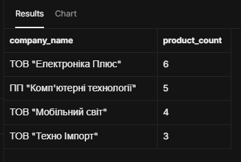

**Пояснення:** групування товарів за постачальником із фільтрацією груп через `HAVING`. Чотири постачальники мають 6, 5, 4 і 3 товари (разом 18 із 25). **Складність:** одне з'єднання та групування, `O(n)`. **Оптимізація:** індекс `products(supplier_id)`.

#### 3. Базові підзапити

**Завдання 3.1:** Товари з ціною вище середньої по категорії

```sql
SELECT p.product_name, p.unit_price, c.category_name
FROM products p
INNER JOIN categories c ON p.category_id = c.category_id
WHERE p.unit_price > (
    SELECT AVG(p2.unit_price)
    FROM products p2
    WHERE p2.category_id = p.category_id
)
ORDER BY c.category_name, p.unit_price DESC;
```

**Результат виконання:**

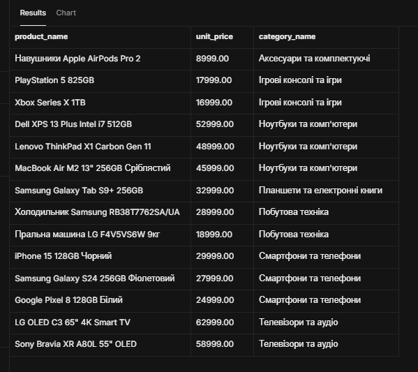

**Пояснення:** корельований підзапит: для кожного товару обчислюється середня ціна його категорії (`p2.category_id = p.category_id`), після чого товар порівнюється з цим значенням. Отримано 14 товарів. **Складність:** підзапит виконується для кожного рядка зовнішнього запиту, тобто приблизно `O(n × розмір категорії)`. **Оптимізація:** індекс `products(category_id, unit_price)` або заміна на віконну функцію `AVG(unit_price) OVER (PARTITION BY category_id)`, яка рахує середнє за один прохід.

**Завдання 3.2:** Клієнти із замовленнями у 2024 році

```sql
SELECT c.customer_id, c.contact_name, c.customer_type
FROM customers c
WHERE c.customer_id IN (
    SELECT o.customer_id
    FROM orders o
    WHERE o.order_date >= '2024-01-01'
      AND o.order_date <  '2025-01-01'
)
ORDER BY c.contact_name;
```

**Результат виконання:**

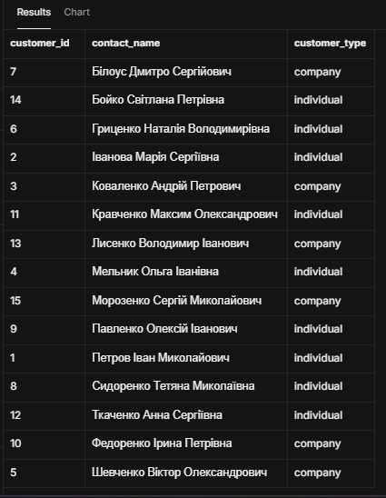

**Пояснення:** підзапит повертає список `customer_id` клієнтів із замовленнями у 2024 році, зовнішній запит дістає їхні дані. Усі 15 клієнтів мали замовлення. Діапазон дат використано замість `EXTRACT(YEAR ...) = 2024`, щоб запит міг користуватися індексом по даті. **Складність:** підзапит виконується один раз (некорельований), далі напівз'єднання, `O(n)`. **Оптимізація:** індекс `orders(order_date)` або `orders(customer_id, order_date)`; на великих обсягах `EXISTS`.

**Завдання 3.3:** Товари із загальною кількістю продажів (підзапит у SELECT)

```sql
SELECT p.product_id,
       p.product_name,
       p.unit_price,
       (SELECT COALESCE(SUM(oi.quantity), 0)
        FROM order_items oi
        WHERE oi.product_id = p.product_id) AS total_sold
FROM products p
ORDER BY total_sold DESC, p.product_name;
```

**Результат виконання:**

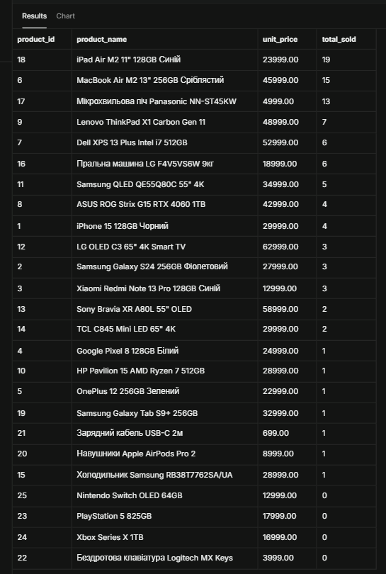

**Пояснення:** скалярний корельований підзапит у `SELECT` повертає суму `quantity` для кожного товару. `COALESCE` замінює NULL на 0 для товарів без продажів (їх чотири). **Складність:** підзапит виконується для кожного товару, `O(n × m)` без індексу. **Оптимізація:** індекс `order_items(product_id)` або переписування через `LEFT JOIN ... GROUP BY`.

**Завдання 3.4:** Оператор EXISTS - товари, які жодного разу не продавалися

```sql
SELECT p.product_id, p.product_name, p.unit_price
FROM products p
WHERE NOT EXISTS (
    SELECT 1
    FROM order_items oi
    WHERE oi.product_id = p.product_id
)
ORDER BY p.product_name;
```

**Результат виконання:**

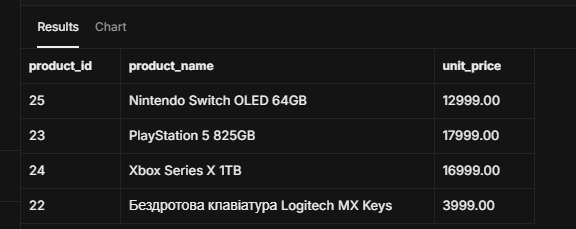

**Пояснення:** `NOT EXISTS` залишає товар, лише якщо підзапит не знайшов жодного рядка в `order_items`. Результат (4 товари) збігається з нульовими продажами в 3.3. `EXISTS` зупиняється на першому знайденому рядку, тому зазвичай ефективніший за `IN` на великих підзапитах і коректно працює з NULL. **Складність:** напівз'єднання (anti join), `O(n)` з індексом на `order_items(product_id)`.

---

### Рівень 2

#### 4. Складні з'єднання

**Завдання 4.1:** RIGHT JOIN - аналіз категорій та товарів

```sql
SELECT c.category_name,
       COUNT(p.product_id) AS products_count,
       COALESCE(ROUND(AVG(p.unit_price), 2), 0) AS avg_price
FROM products p
RIGHT JOIN categories c ON p.category_id = c.category_id
GROUP BY c.category_id, c.category_name
ORDER BY products_count DESC, c.category_name;
```

**Результат виконання:**

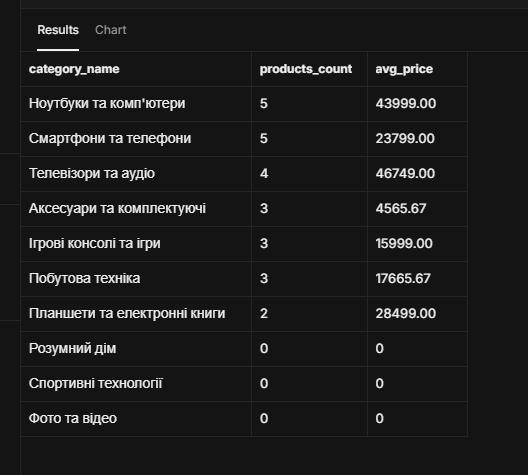

**Пояснення:** `RIGHT JOIN` зберігає всі категорії (права таблиця), навіть без товарів; `COALESCE` замінює NULL середньої ціни на 0. Результат аналогічний 2.1, але записаний через `RIGHT JOIN`; на практиці такий запит зазвичай переписують у `LEFT JOIN` для читабельності.

**Завдання 4.2:** Self-join - співробітники та керівники

```sql
SELECT e1.first_name || ' ' || e1.last_name AS employee,
       e1.title                              AS employee_title,
       e2.first_name || ' ' || e2.last_name AS manager,
       e2.title                              AS manager_title
FROM employees e1
LEFT JOIN employees e2 ON e1.reports_to = e2.employee_id
ORDER BY e2.last_name NULLS FIRST, e1.last_name;
```

**Результат виконання:**

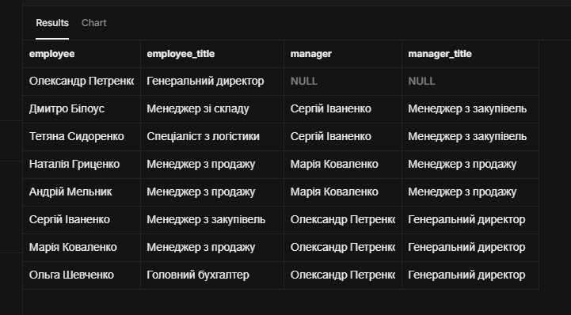

**Пояснення:** таблиця `employees` з'єднується сама з собою під двома псевдонімами (`e1` - підлеглий, `e2` - керівник). `LEFT JOIN` зберігає генерального директора, у якого `reports_to IS NULL`.

**Завдання 4.3:** FULL OUTER JOIN - пошук «неспівпадінь» між категоріями та товарами

```sql
SELECT c.category_id,
       c.category_name,
       p.product_id,
       p.product_name
FROM categories c
FULL OUTER JOIN products p ON c.category_id = p.category_id
WHERE c.category_id IS NULL
   OR p.product_id  IS NULL
ORDER BY c.category_name, p.product_name;
```

**Результат виконання:**

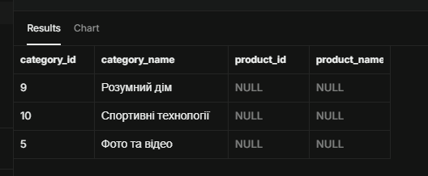

**Пояснення:** `FULL OUTER JOIN` повертає рядки обох таблиць, навіть без пари. Фільтр залишає лише «неспівпадіння»: категорії без товарів (три рядки) або товари без категорії (таких немає).

**Завдання 4.4:** Умовне з'єднання - додаткова умова в ON

```sql
SELECT cu.contact_name,
       cu.customer_type,
       COUNT(o.order_id)           AS delivered_orders,
       COALESCE(SUM(o.freight), 0) AS delivered_freight
FROM customers cu
LEFT JOIN orders o
       ON o.customer_id  = cu.customer_id
      AND o.order_status = 'delivered'
GROUP BY cu.customer_id, cu.contact_name, cu.customer_type
ORDER BY delivered_orders DESC, cu.contact_name;
```

**Результат виконання:**

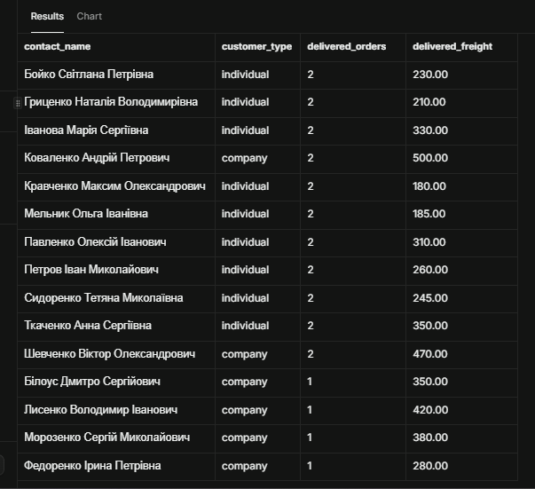

**Пояснення:** умова `o.order_status = 'delivered'` розміщена в `ON`, а не у `WHERE`, тому фільтрує лише приєднувані замовлення, а клієнти без доставлених замовлень залишаються в результаті з нулями. Якби цю умову перенести у `WHERE`, `LEFT JOIN` фактично став би `INNER JOIN`. У наших даних кожен клієнт має доставлене замовлення, тому різниця на результаті не видна, але семантика запиту від цього не змінюється.

#### 5. Віконні функції

**Завдання 5.1:** Ранжування товарів за ціною в категоріях

```sql
SELECT p.product_name,
       c.category_name,
       p.unit_price,
       RANK()       OVER (PARTITION BY c.category_name ORDER BY p.unit_price DESC) AS price_rank,
       DENSE_RANK() OVER (PARTITION BY c.category_name ORDER BY p.unit_price DESC) AS price_dense_rank,
       ROW_NUMBER() OVER (PARTITION BY c.category_name ORDER BY p.unit_price DESC) AS row_num
FROM products p
JOIN categories c ON p.category_id = c.category_id
ORDER BY c.category_name, p.unit_price DESC;
```

**Результат виконання:**

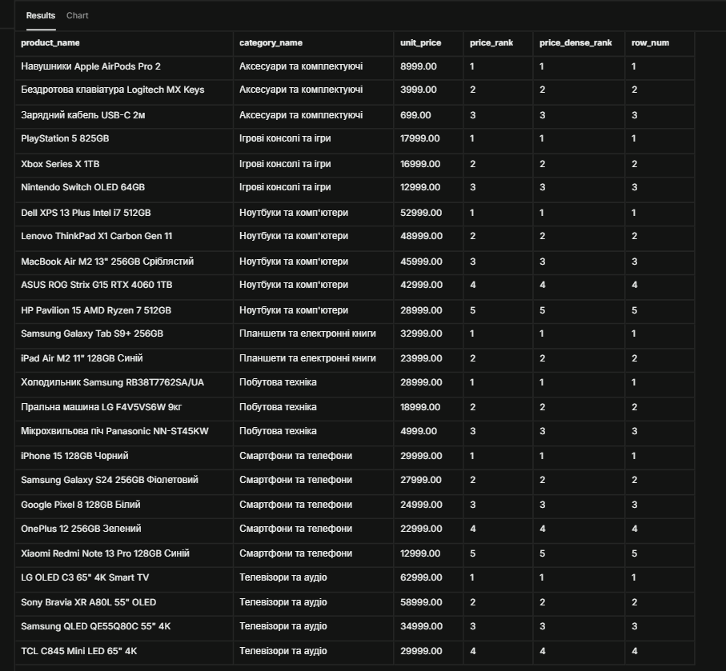

**Пояснення:** `PARTITION BY` нумерує товари всередині кожної категорії. У нашій базі ціни в межах категорії різні, тому всі три функції дали однакові значення.

**Завдання 5.2:** Порівняння замовлень з попередніми датами

```sql
SELECT cu.contact_name,
       o.order_id,
       o.order_date,
       o.freight,
       LAG(o.order_date)  OVER w AS prev_order_date,
       LEAD(o.order_date) OVER w AS next_order_date,
       o.order_date - LAG(o.order_date) OVER w AS days_since_prev,
       o.freight - LAG(o.freight, 1, 0) OVER w AS freight_change
FROM orders o
JOIN customers cu ON o.customer_id = cu.customer_id
WINDOW w AS (PARTITION BY o.customer_id ORDER BY o.order_date, o.order_id)
ORDER BY cu.contact_name, o.order_date, o.order_id;
```

**Результат виконання:**

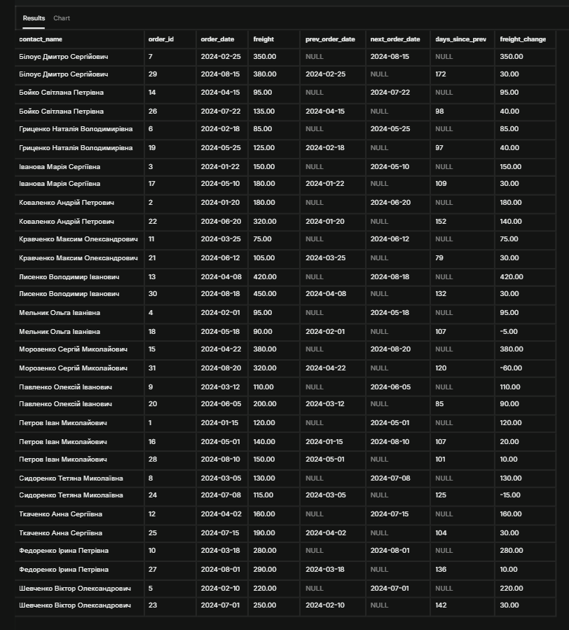

**Пояснення:** `LAG` та `LEAD` беруть значення попереднього та наступного замовлення того самого клієнта (`PARTITION BY customer_id`). Для першого замовлення `prev_order_date` = NULL, для останнього `next_order_date` = NULL. Приклад перевірки: у Білоуса Дмитра між замовленнями від 25.02.2024 і 15.08.2024 рівно 172 дні, зміна вартості доставки 380 − 350 = 30.

**Завдання 5.3:** Різниця між RANK, DENSE_RANK та ROW_NUMBER (демонстрація на даних зі збігом цін)

```sql
WITH demo(product_name, unit_price) AS (
    VALUES ('Товар A', 1000),
           ('Товар B',  800),
           ('Товар C',  800),
           ('Товар D',  600)
)
SELECT product_name,
       unit_price,
       ROW_NUMBER() OVER (ORDER BY unit_price DESC) AS row_num,
       RANK()       OVER (ORDER BY unit_price DESC) AS rank_num,
       DENSE_RANK() OVER (ORDER BY unit_price DESC) AS dense_rank_num
FROM demo
ORDER BY unit_price DESC, product_name;
```

**Результат виконання:**

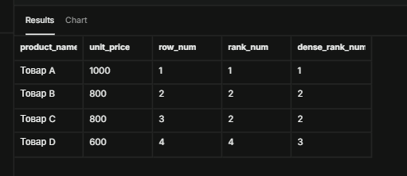

**Пояснення (відповідь на контрольне запитання 7):** для цін 1000, 800, 800, 600 `ROW_NUMBER` дає 1-2-3-4 (завжди унікальні), `RANK` дає 1-2-2-4 (пропуск після однакових значень), `DENSE_RANK` дає 1-2-2-3 (без пропусків).

---

### Рівень 3

#### 6. Матеріалізовані представлення, рекурсивні запити та параметризована аналітика

**Завдання 6.1:** Матеріалізоване представлення для аналізу продажів

```sql
CREATE MATERIALIZED VIEW mv_monthly_sales AS
SELECT
    EXTRACT(YEAR  FROM o.order_date)::int AS year,
    EXTRACT(MONTH FROM o.order_date)::int AS month,
    c.category_name,
    r.region_name,
    SUM(oi.quantity * oi.unit_price * (1 - oi.discount))        AS total_revenue,
    COUNT(DISTINCT o.order_id)                                   AS orders_count,
    ROUND(SUM(oi.quantity * oi.unit_price * (1 - oi.discount))
          / COUNT(DISTINCT o.order_id), 2)                       AS avg_order_value
FROM orders o
JOIN order_items oi ON o.order_id    = oi.order_id
JOIN products    p  ON oi.product_id = p.product_id
JOIN categories  c  ON p.category_id = c.category_id
JOIN customers   cu ON o.customer_id = cu.customer_id
LEFT JOIN regions r ON cu.region_id  = r.region_id
WHERE o.order_status = 'delivered'
GROUP BY 1, 2, c.category_name, r.region_name;

CREATE INDEX idx_mv_monthly_sales_date ON mv_monthly_sales(year, month);

SELECT * FROM mv_monthly_sales
ORDER BY year, month, total_revenue DESC
LIMIT 15;
```

**Результат виконання:**

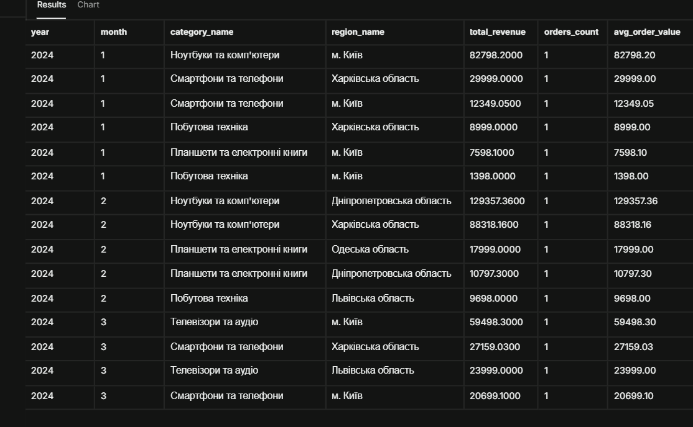

**Пояснення:** матеріалізоване представлення один раз виконує важкий аналітичний запит (5 з'єднань і групування) та фізично зберігає результат на диску. Звернення до нього читає готову таблицю, а не перераховує все заново, а по ньому можна створювати індекси (як `idx_mv_monthly_sales_date`). Недолік: дані застарівають, тому їх потрібно оновлювати командою `REFRESH MATERIALIZED VIEW mv_monthly_sales;` (за розкладом або після завантаження нових даних). У порівнянні з методичкою `avg_order_value` обчислюється як виручка, поділена на кількість замовлень (середня вартість замовлення), а не `AVG` по рядках позицій.

**Завдання 6.2:** Рекурсивний запит для ієрархії співробітників

```sql
WITH RECURSIVE employee_hierarchy AS (
    SELECT employee_id, first_name, last_name, title, reports_to,
           0 AS level,
           CAST(last_name || ' ' || first_name AS VARCHAR(1000)) AS hierarchy_path
    FROM employees
    WHERE reports_to IS NULL

    UNION ALL

    SELECT e.employee_id, e.first_name, e.last_name, e.title, e.reports_to,
           eh.level + 1,
           CAST(eh.hierarchy_path || ' -> ' || e.last_name || ' ' || e.first_name AS VARCHAR(1000))
    FROM employees e
    JOIN employee_hierarchy eh ON e.reports_to = eh.employee_id
    WHERE eh.level < 10
)
SELECT employee_id, first_name, last_name, title, level, hierarchy_path
FROM employee_hierarchy
ORDER BY hierarchy_path;
```

**Результат виконання:**

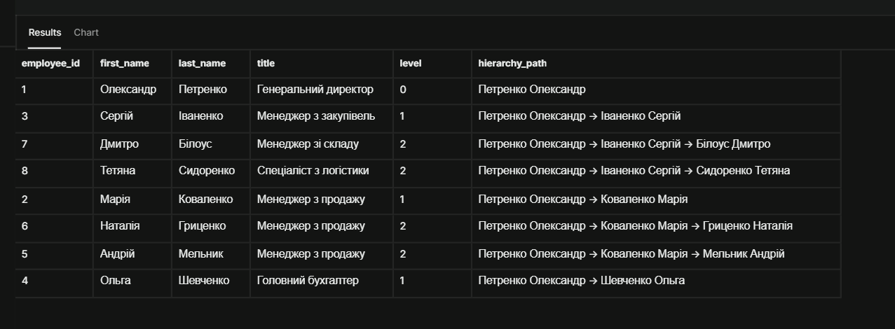

**Пояснення:** базова частина вибирає топ-менеджера (`reports_to IS NULL`, рівень 0), рекурсивна на кожному кроці знаходить підлеглих попереднього рівня і збільшує `level`. Умова `eh.level < 10` захищає від нескінченного циклу. Отримано 8 співробітників на трьох рівнях.

**Завдання 6.3:** Функція з динамічним SQL для параметризованої аналітики

```sql
CREATE OR REPLACE FUNCTION get_sales_report(
    p_date_from     date DEFAULT '2024-01-01',
    p_date_to       date DEFAULT '2025-01-01',
    p_customer_type text DEFAULT NULL,
    p_group_by      text DEFAULT 'category'
)
RETURNS TABLE (group_name text, orders_count bigint, total_revenue numeric)
LANGUAGE plpgsql
AS $$
DECLARE
    v_col text;
BEGIN
    -- Білий список розрізів: захист від SQL-ін'єкцій
    v_col := CASE p_group_by
        WHEN 'category' THEN 'c.category_name'
        WHEN 'region'   THEN 'r.region_name'
        WHEN 'supplier' THEN 's.company_name'
        ELSE NULL
    END;

    IF v_col IS NULL THEN
        RAISE EXCEPTION 'Невідомий розріз: %. Дозволено: category, region, supplier', p_group_by;
    END IF;

    RETURN QUERY EXECUTE format($q$
        SELECT %s::text,
               COUNT(DISTINCT o.order_id),
               SUM(oi.quantity * oi.unit_price * (1 - oi.discount))::numeric
        FROM orders o
        JOIN order_items oi ON o.order_id    = oi.order_id
        JOIN products    p  ON oi.product_id = p.product_id
        JOIN categories  c  ON p.category_id = c.category_id
        JOIN suppliers   s  ON p.supplier_id = s.supplier_id
        JOIN customers   cu ON o.customer_id = cu.customer_id
        LEFT JOIN regions r ON cu.region_id  = r.region_id
        WHERE o.order_date >= $1
          AND o.order_date <  $2
          AND ($3 IS NULL OR cu.customer_type = $3)
        GROUP BY 1
        ORDER BY 3 DESC
    $q$, v_col)
    USING p_date_from, p_date_to, p_customer_type;
END;
$$;
```

**Виклик 1:** значення за замовчуванням (розріз по категоріях, 2024 рік)

```sql
SELECT * FROM get_sales_report();
```

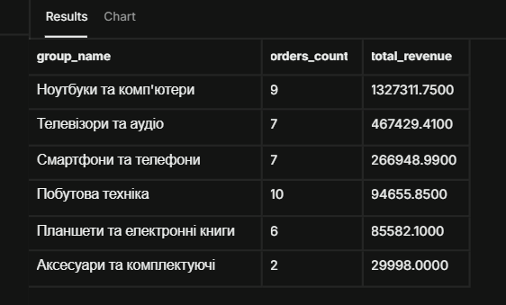

**Виклик 2:** розріз по регіонах, лише клієнти-компанії

```sql
SELECT * FROM get_sales_report('2024-01-01', '2025-01-01', 'company', 'region');
```

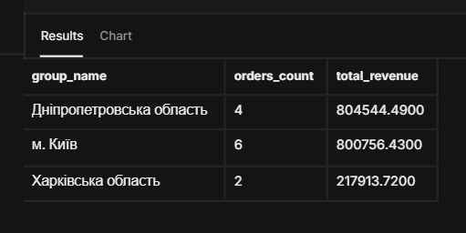

**Виклик 3:** розріз по постачальниках, травень-серпень 2024, без фільтра за типом клієнта

```sql
SELECT * FROM get_sales_report('2024-05-01', '2024-09-01', NULL, 'supplier');
```

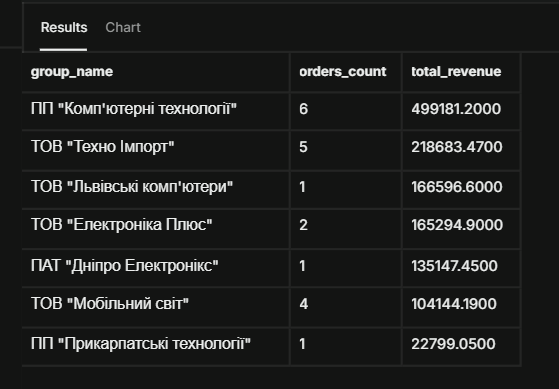

**Пояснення:** назва стовпця для групування вибирається з білого списку (`CASE`) і підставляється в текст запиту через `format()` (динамічний SQL). Значення від користувача (дати, тип клієнта) передаються окремо через `USING` як параметри `$1`, `$2`, `$3`, тому не можуть змінити структуру запиту (захист від SQL-ін'єкцій). Умова `($3 IS NULL OR ...)` робить фільтр за типом клієнта необов'язковим. Недозволений розріз викликає помилку з поясненням. Виручка за категоріями тут включає замовлення в усіх статусах, на відміну від матеріалізованого представлення 6.1, де лише `delivered`.

---

## Аналіз продуктивності

### Дослідження планів виконання

**Найповільніший (найскладніший) запит:** 2.2, продажі за регіонами (3 з'єднання, агрегація, `HAVING`, сортування).

```sql
EXPLAIN (ANALYZE, BUFFERS)
SELECT r.region_name,
       COUNT(DISTINCT o.order_id) AS orders_count,
       SUM(oi.quantity * oi.unit_price * (1 - oi.discount)) AS total_sales
FROM orders o
JOIN customers   cu ON o.customer_id = cu.customer_id
JOIN regions     r  ON cu.region_id  = r.region_id
JOIN order_items oi ON o.order_id    = oi.order_id
GROUP BY r.region_id, r.region_name
HAVING SUM(oi.quantity * oi.unit_price * (1 - oi.discount)) > 100000
ORDER BY total_sales DESC;
```

**План виконання (EXPLAIN ANALYZE) до створення індексів:**

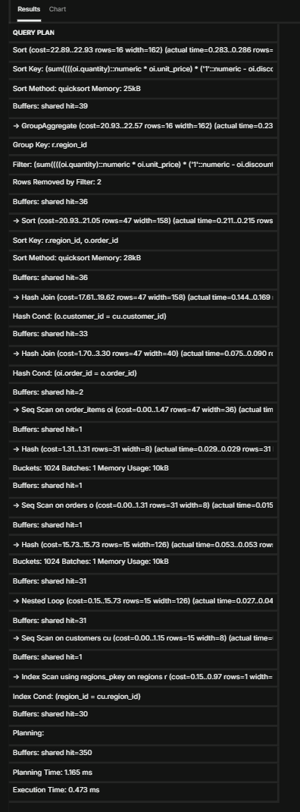

У плані `order_items`, `orders`, `customers` читаються повним скануванням (`Seq Scan`), з'єднання виконуються як `Hash Join`, для `regions` використано `Index Scan` по первинному ключу. `Planning Time: 1.165 ms`, `Execution Time: 0.473 ms`.

**Запропоновані оптимізації:**
1. Індекси на зовнішні ключі, що беруть участь у з'єднаннях (`orders.customer_id`, `order_items.order_id`, `order_items.product_id`, `customers.region_id`, `products.category_id`, `products.supplier_id`). У PostgreSQL вони не створюються автоматично, на відміну від первинних ключів.
2. Оновлення статистики командою `ANALYZE`, щоб планувальник мав актуальні оцінки кількості рядків.
3. Для повторюваних звітів - матеріалізоване представлення (6.1), яке виконує агрегацію один раз.

### Створені індекси

**Індекс 1:**
```sql
CREATE INDEX IF NOT EXISTS idx_orders_customer_date ON orders(customer_id, order_date);
```
**Обґрунтування:** прискорює з'єднання `orders → customers` та вибірки замовлень клієнта за період (запити 3.2, 5.2, функція 6.3).

**Індекс 2:**
```sql
CREATE INDEX IF NOT EXISTS idx_order_items_order ON order_items(order_id);
```
**Обґрунтування:** `order_items` - найбільша таблиця, а з'єднання з `orders` присутнє майже в усіх запитах.

**Інші створені індекси:**
```sql
CREATE INDEX IF NOT EXISTS idx_order_items_product ON order_items(product_id);
CREATE INDEX IF NOT EXISTS idx_products_category   ON products(category_id, unit_price);
CREATE INDEX IF NOT EXISTS idx_products_supplier   ON products(supplier_id);
CREATE INDEX IF NOT EXISTS idx_customers_region    ON customers(region_id);
ANALYZE;
```
**Обґрунтування:** `order_items(product_id)` - для підзапитів 3.3, 3.4; `products(category_id, unit_price)` - для групування за категорією, 3.1 і ранжування; `products(supplier_id)` - для 2.3; `customers(region_id)` - для групування за регіонами.

**План виконання після створення індексів і `ANALYZE`:**

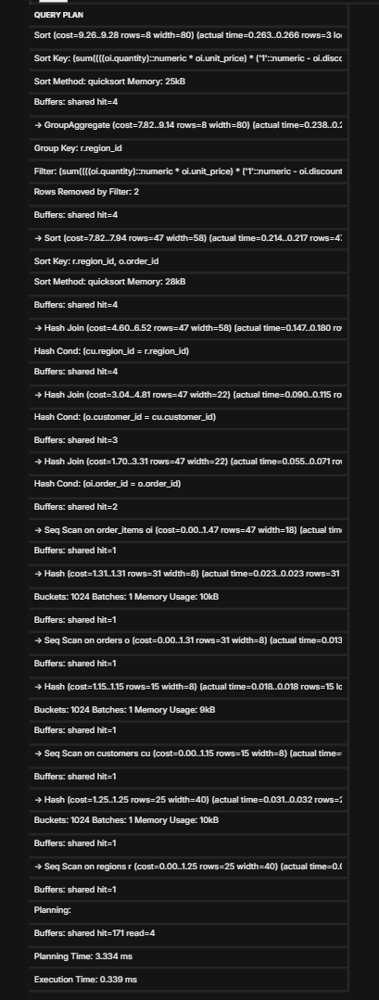

Усі таблиці й далі читаються через `Seq Scan`. `Execution Time` зменшився з 0.473 мс до 0.339 мс, але нові індекси планувальник **не використав**. Різниця пояснюється оновленою статистикою (`ANALYZE`) та іншим порядком з'єднань, а не індексами, і на таких обсягах (десятки рядків) лежить у межах похибки вимірювання. Тому ми не стверджуємо, що індекси прискорили запит.

**Демонстрація роботи індексів** (тимчасово `SET enable_seqscan = off`, потім `RESET enable_seqscan`):

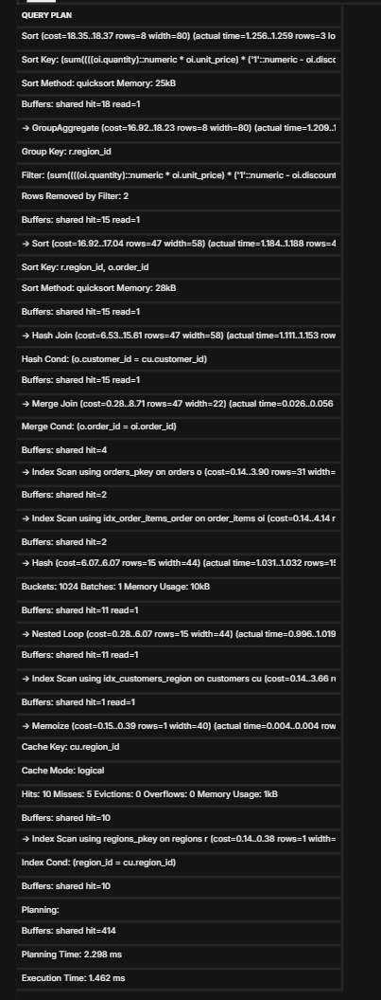

Тепер у плані використані `idx_order_items_order`, `idx_customers_region` та первинні ключі (`Index Scan`, `Merge Join`, `Nested Loop`), але `Execution Time` зріс до 1.462 мс. Висновок: на малих таблицях повне сканування дешевше за звернення до індексу, і планувальник обрав його правильно. Індекс стає вигідним, коли таблиця велика, а вибірка вибіркова. Індекс `idx_orders_customer_date` у цьому запиті не потрібен, бо запит не фільтрує за датою; він корисний для запитів 3.2, 5.2 і 6.3.

**Підсумок за планами:**

| Варіант | Planning Time | Execution Time | Оцінена вартість (верхній вузол) |
|---|---|---|---|
| До індексів | 1.165 мс | 0.473 мс | 22.93 |
| Після індексів і ANALYZE | 3.334 мс | 0.339 мс | 9.28 |
| Seq Scan вимкнено | 2.298 мс | 1.462 мс | 18.37 |

---

## Порівняльний аналіз

### Ефективність різних підходів

**Завдання:** Знайти топ-5 найдорожчих товарів у кожній категорії

**Підхід 1: Віконні функції**
```sql
EXPLAIN ANALYZE
SELECT product_name, category_name, unit_price, rn
FROM (
    SELECT p.product_name,
           c.category_name,
           p.unit_price,
           ROW_NUMBER() OVER (PARTITION BY p.category_id ORDER BY p.unit_price DESC) AS rn
    FROM products p
    JOIN categories c ON p.category_id = c.category_id
) ranked
WHERE rn <= 5
ORDER BY category_name, rn;
```

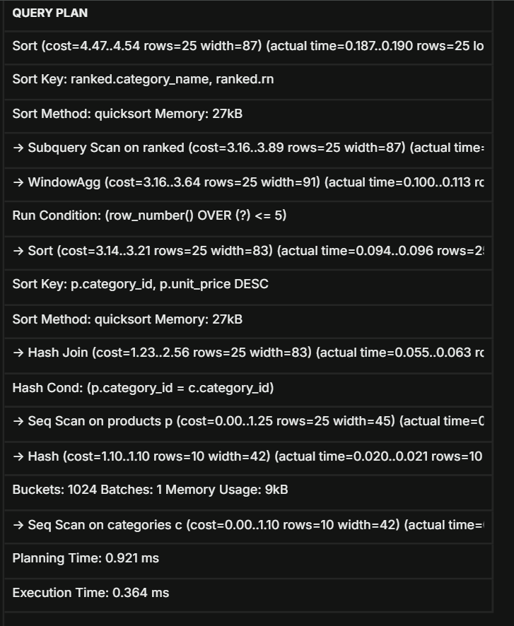

**Підхід 2: Корельований підзапит**
```sql
EXPLAIN ANALYZE
SELECT p.product_name,
       c.category_name,
       p.unit_price
FROM products p
JOIN categories c ON p.category_id = c.category_id
WHERE (
    SELECT COUNT(*)
    FROM products p2
    WHERE p2.category_id = p.category_id
      AND p2.unit_price  > p.unit_price
) < 5
ORDER BY c.category_name, p.unit_price DESC;
```

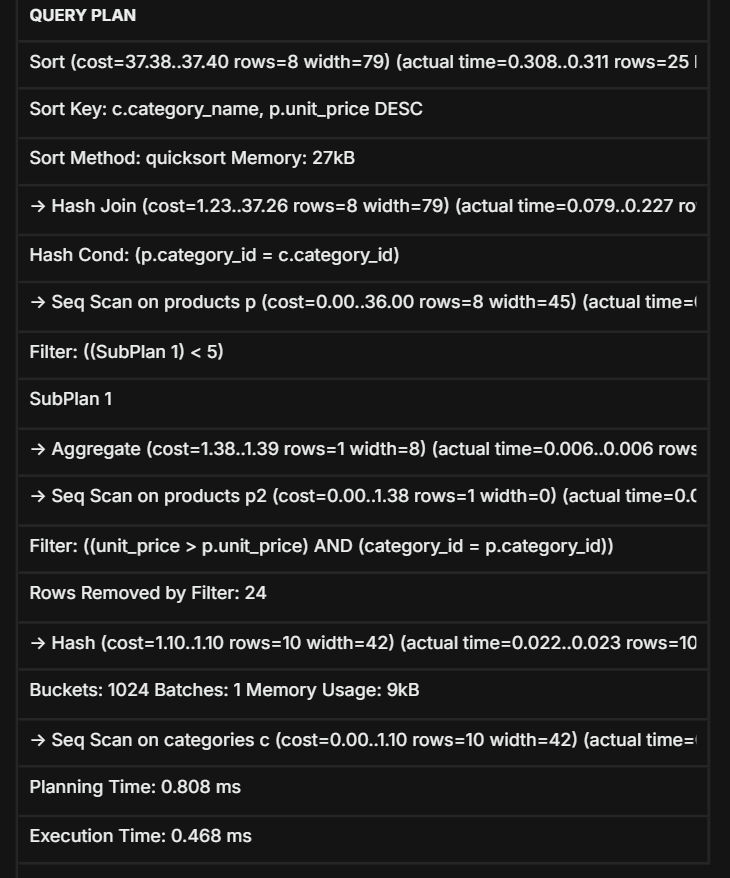

**Час виконання:**
- Віконні функції: Planning 0.921 мс, Execution 0.364 мс, оцінена вартість верхнього вузла 4.54
- Корельований підзапит: Planning 0.808 мс, Execution 0.468 мс, оцінена вартість верхнього вузла 37.40

**Висновок:** у цій базі в кожній категорії не більше 5 товарів, тому обидва запити повертають усі 25 товарів, а різниця в часі (0.364 проти 0.468 мс) на таких даних незначна. Структура планів відрізняється принципово: віконна функція читає `products` один раз, сортує та нумерує за один прохід (`WindowAgg`), а корельований підзапит виконує `SubPlan` (повторне сканування `products`) для кожного рядка зовнішньої таблиці. Це видно за оцінкою вартості (4.54 проти 37.40), тому на великих обсягах віконні функції масштабуються значно краще (приблизно `O(n log n)` проти `O(n²)` у межах категорії). Ще одна відмінність: `ROW_NUMBER` жорстко відсікає рівно 5 рядків, а підзапит `COUNT(...) < 5` повертає більше 5 рядків, якщо кілька товарів на межі мають однакову ціну. У наших даних збігів цін у межах категорії немає, тому результати ідентичні.

---

## Висновки

У роботі виконано завдання трьох рівнів на базі `technomart` у PostgreSQL (Supabase): з'єднання таблиць (`INNER`, `LEFT`, `RIGHT`, `FULL OUTER`, self-join, умовне з'єднання), агрегатні функції з `GROUP BY` та `HAVING`, підзапити (у `WHERE`, `SELECT`, `IN`, `EXISTS`), віконні функції (`RANK`, `DENSE_RANK`, `ROW_NUMBER`, `LAG`, `LEAD`, `PARTITION BY`), матеріалізоване представлення, рекурсивний CTE та функцію з динамічним SQL. Проведено аналіз планів виконання `EXPLAIN ANALYZE`, створено індекси та порівняно два підходи до задачі «топ-N у групі». Окремо зафіксовано, що на малому обсязі даних індекси не дають виграшу, а планувальник правильно віддає перевагу повному скануванню.

**Самооцінка**: [ваша оцінка роботи, 3-5]

**Обгрунтування**: [обґрунтування самооцінки]
